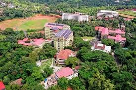

# SJEC 2.5D Digital Twin — St Joseph Engineering College Campus Map

A photorealistic, interactive 2.5D digital twin and campus navigation system for **St Joseph Engineering College (SJEC), Vamanjoor, Mangaluru, Karnataka, India**.



---

## Features

### 1. Photo-Grounded 2.5D Architectural Digital Twin
- **Authentic Building Materials**: Built using real photographic ground truth from SJEC — warm olive-sage concrete stucco, cylindrical structural columns, brise-soleil box sunshades, dark laterite masonry plinths, and authentic Mangalore clay terracotta roofs.
- **Architectural Extrusions**: Multi-tiered 3D modeling including foundation plinths ($0\text{--}1.4\text{ m}$), main facade body with directional sunlight shading, and custom 3D roof features:
  - **Administrative Block**: Multi-tiered hipped terracotta pagoda roof, portico colonnade, and the iconic circular lawn mound with the patron Saint Joseph statue.
  - **Academic Block III (AB-III)**: 9-storey (34m) engineering research tower with modern curtain glass framing and the 300 kWp rooftop solar photovoltaic array.
  - **Academic Block I & II**: 5-storey engineering wings with protruding concrete sunshades, curved portico canopy, and terracotta gabled wings.
  - **Saint Pio Chapel**: Whitewashed cruciform sanctuary with soaring concrete Cross Tower and stained glass accents.
  - **Saint Joseph Boys Hostel**: 7-storey hillside residential block with dark masonry plinths and individual room sunshades.
  - **Bethania VIP House**: Modern architectural villa with dark reflective curtain glass panels.
  - **Main Entrance Gate**: Highway entrance with signature quadruple sage-green pylons and central security kiosk.

### 2. Verified Campus Grounds & Athletic Facilities
- **Josarena Open-Air Amphitheatre**: Concentric fan-shaped amphitheatre with alternating lawn terraces and stone step seating built into the natural slope, completed with an elevated stone performance stage.
- **FIBA Basketball Court**: Photo-matched regulation acrylic court featuring light concrete grey playing surface, golden-yellow 3-point floor apron, terracotta-red key free-throw boxes, and sky-blue center jump circles.
- **400m Athletic Running Track**: Terracotta synthetic track with 6 crisp white running lane stripes enclosing a central natural grass football pitch.
- **Student Square & Quads**: Sandstone interlocking paver promenades connecting Academic Blocks I, II, III, and the Administrative Block.
- **Lush Tropical Greenery**: 3D canopies of coconut palms, teak, and mango trees mirroring the coastal Karnataka landscape.

### 3. Interactive AR Intelligence & Navigation
- **Verified Photo Inspection**: Every major building drawer showcases real high-resolution photography with a tap-to-expand lightbox preview.
- **Camera View Presets**: One-click camera presets to jump directly to iconic photo landmarks:
  - 📷 *Campus Overview (North Up)*
  - 📷 *Student Square & Basketball Court*
  - 📷 *Josarena Open-Air Amphitheatre*
  - 📷 *Main Entrance Gate*
  - 📷 *Athletic Stadium & 400m Track*
  - 📷 *2D Architectural Masterplan*
- **3D Cinematic Drone Tour**: Automated 360° orbiting camera tour.
- **Pedestrian Navigation**: Dijkstra-based shortest-path walking guide between campus facilities with step-by-step route telemetry.
- **Strict Campus Boundary**: Cleanly masked non-campus Vamanjoor terrain with camera bounds confinement.

---

## Tech Stack
- **Mapping Engine**: MapLibre GL JS
- **Frontend Framework**: React 18 + Vite
- **Styling**: Tailwind CSS
- **Icons**: Lucide React
- **Geospatial Processing**: Turf.js + OpenStreetMap (OSM) GeoJSON

---

## Getting Started

### Prerequisites
- Node.js (v18 or higher)
- npm or yarn

### Installation
```bash
# Clone repository
git clone https://github.com/Srijan0018/campus.git
cd campus

# Install dependencies
npm install

# Start local development server
npm run dev
```

### Production Build
```bash
# Compile optimized bundle
npm run build

# Preview production build locally
npm run preview
```

---

## Data Attribution
- Real campus boundary, building footprints, and highway geometry derived from OpenStreetMap contributors under ODbL.
- Visual ground truth and photographic validation sourced from St Joseph Engineering College (SJEC), Vamanjoor, Mangaluru.
